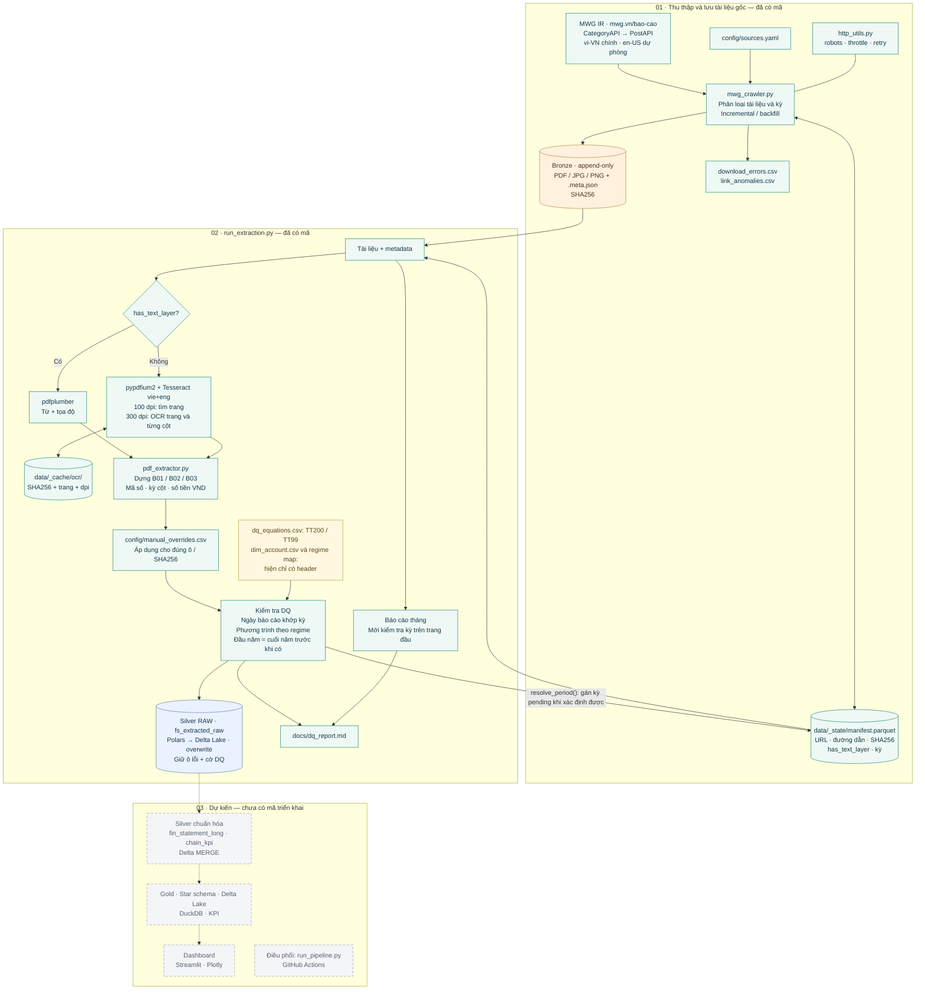

# Sơ đồ codebase MWG Financial Data Lakehouse

Ảnh: [mwg-codebase-architecture.png](diagrams/mwg-codebase-architecture.png).

Đối chiếu mã nguồn ngày **12/11/2026**. Nét liền biểu thị phần đã có mã; nét đứt biểu thị lộ trình trong `CLAUDE.md`.

Luồng hiện có kết thúc tại **Silver raw** (`data/silver/fs_extracted_raw`), chưa có bước chuẩn hóa Silver, Gold hoặc dashboard. Bảng raw được ghi đè và giữ cả ô không qua DQ, kèm `dq_balance_ok` và `period_check_ok`; DQ ở đây không phải bộ lọc trước khi lưu raw.

Các chi tiết được kiểm tra trực tiếp:

- [Crawler](../src/ingestion/mwg_crawler.py): danh sách JSON API, ưu tiên ngôn ngữ, manifest, Bronze và gán lại kỳ.
- [HTTP](../src/ingestion/http_utils.py): robots, throttle, retry và xử lý lỗi.
- [Điều phối bóc tách](../src/extraction/run_extraction.py): nạp manifest, chạy nhiều process, áp dụng override, kiểm tra DQ, ghi Delta raw và báo cáo.
- [OCR](../src/extraction/ocr.py): hai lượt OCR, đọc lớp text, cache và OCR từng cột.
- [Dựng bảng và DQ](../src/extraction/pdf_extractor.py): dựng dòng/cột, nhận diện regime, phương trình và override.
- `src/transform/` và `src/quality/` hiện chỉ có `__init__.py`; `dashboard/` trống. Chưa có `run_pipeline.py` hoặc workflow GitHub Actions.

Ảnh được tạo bằng công cụ `image_gen`. [Prompt đầy đủ](diagrams/mwg-codebase-architecture.prompt.txt).

