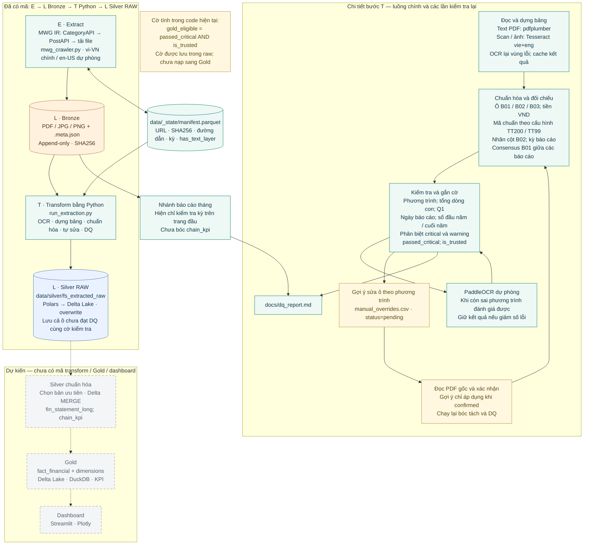

# Luồng ETL/ELT — MWG Financial Data Lakehouse

Ảnh: [mwg-etl-elt-flow.png](diagrams/mwg-etl-elt-flow.png). Đối chiếu mã nguồn ngày **12/11/2026**.

Luồng hiện tại là **E → L (Bronze) → T (Python) → L (Silver raw)**: tải tài liệu từ MWG, lưu nguyên bản, bóc tách và biến đổi bằng Python, sau đó ghi bảng Delta. Đây là cách tổ chức lưu raw trước khi biến đổi, kết hợp bước ETL từ tài liệu sang dữ liệu có cấu trúc; không có bước SQL transform trong warehouse đang chạy.

Sơ đồ tóm tắt theo nhóm công việc. Code thực hiện DQ nhiều lần trong quá trình tự sửa; không phải chỉ kiểm tra một lần ở cuối. PaddleOCR chỉ chạy khi được bật và còn lỗi phương trình phù hợp. Khi giữ được kết quả tốt hơn, code chạy lại consensus và DQ.

Gợi ý sửa tự động được ghi với `status=pending`, không tự áp dụng. Khi người dùng đã đối chiếu PDF gốc và xác nhận, lần chạy sau mới áp dụng gợi ý đó. Bộ nạp override cũng chấp nhận các dòng cũ có status trống.

`gold_eligible` hiện là cờ tại từng ô, được tính bằng `passed_critical and is_trusted`. Bảng raw vẫn giữ các ô có cờ false. Cờ này không có nghĩa đã tồn tại luồng nạp Gold, cũng không thay thế trạng thái qua toàn bộ DQ.

Mã nguồn dùng để đối chiếu:

- [mwg_crawler.py](../src/ingestion/mwg_crawler.py): Extract, Bronze append-only, manifest và gán kỳ.
- [run_extraction.py](../src/extraction/run_extraction.py): điều phối bóc tách, chuẩn hóa, kiểm tra, fallback, tính cờ và ghi Delta raw.
- [ocr.py](../src/extraction/ocr.py): đọc lớp text, Tesseract, OCR lại vùng lỗi và PaddleOCR.
- [pdf_extractor.py](../src/extraction/pdf_extractor.py): dựng bảng, số tiền, chế độ kế toán, DQ và áp dụng override.
- [self_correct.py](../src/extraction/self_correct.py): consensus B01 và ghi gợi ý sửa chờ xác nhận.
- `src/transform/` hiện chỉ có `__init__.py`; `dashboard/` trống.

Ảnh được tạo bằng công cụ `image_gen`, [prompt đầy đủ](diagrams/mwg-etl-elt-flow.prompt.txt). Bản sơ đồ kiến trúc trước đó được giữ nguyên.

